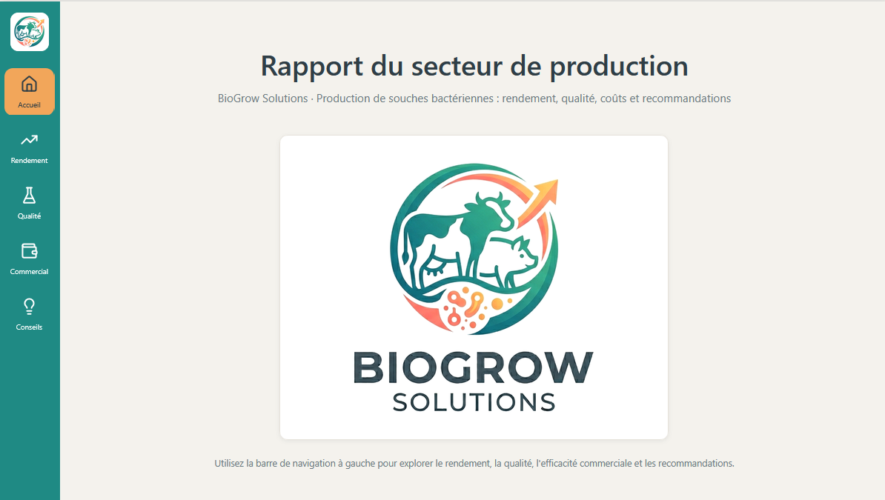
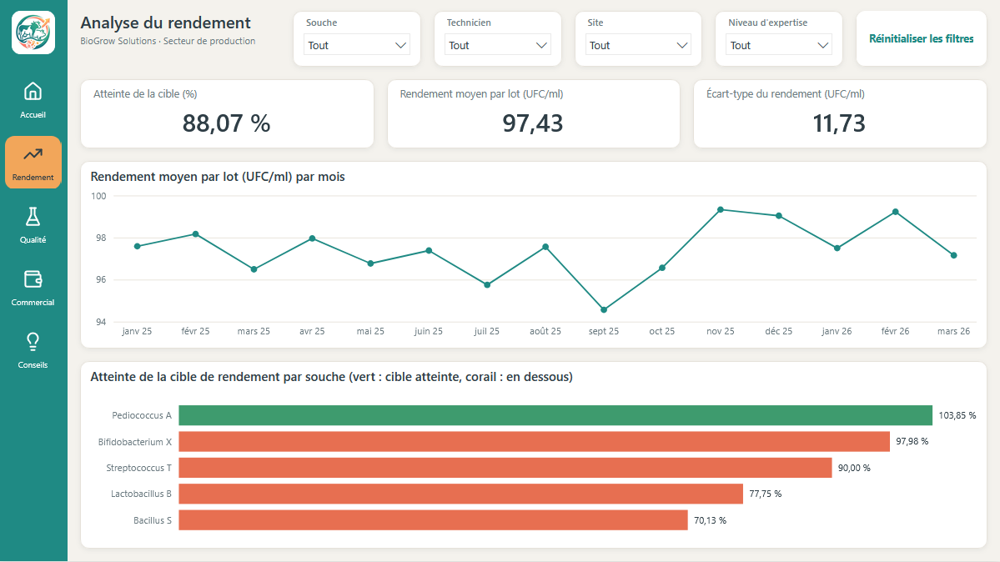
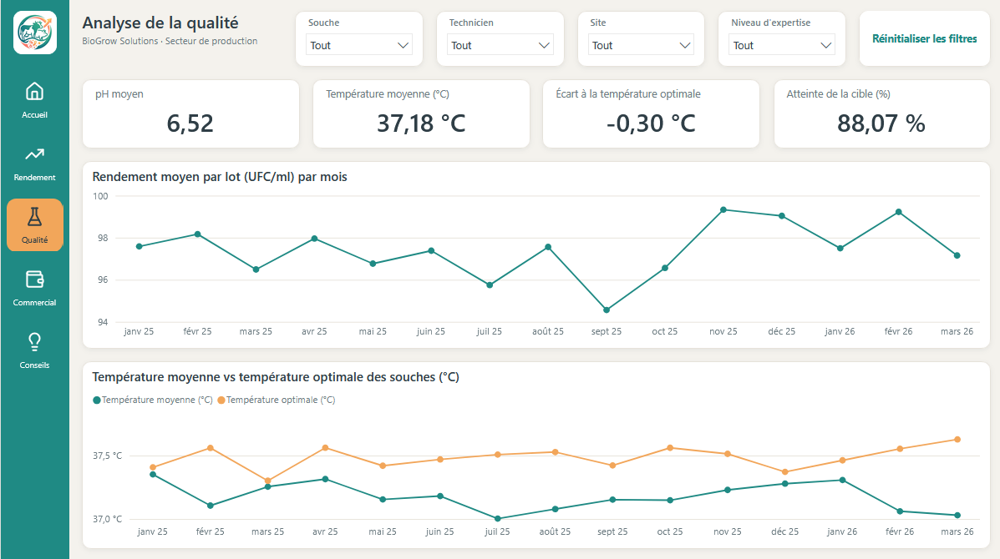
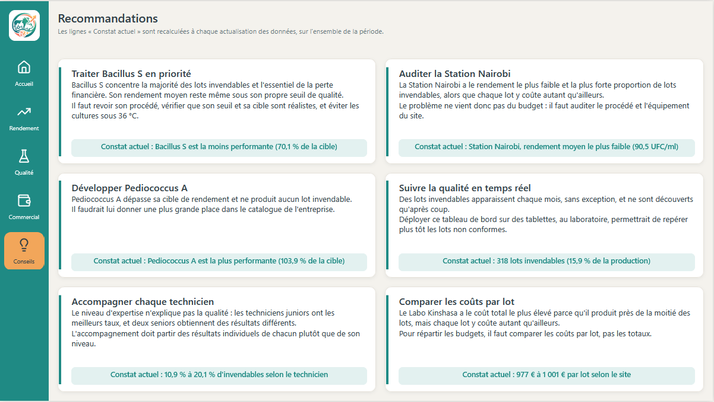

### BioGrow Solutions : pourquoi certains lots de production sont-ils invendables ?

Ce projet est un tableau de bord Power BI construit sur des données fictives. BioGrow Solutions est une entreprise imaginaire qui produit des souches bactériennes, et tous les chiffres ci-dessous sont simulés. Seule la démarche d'analyse est réelle.

Le rapport interactif est consultable en ligne, sans compte Power BI : [ouvrir le rapport](https://app.powerbi.com/view?r=eyJrIjoiNDNhOTM2Y2ItZTY4OS00MzE3LThjZTctNzFhYzgzYzE3ODJlIiwidCI6IjFlODMyYTBmLTdiNWQtNGRmMC1hMjg5LWMyM2Y4YzU4MmIwYSJ9).

#### Le problème

Sur la période étudiée, un lot sur six est invendable : son rendement n'atteint pas le seuil de qualité fixé pour sa souche. Ces lots représentent 317 000 € de coûts de production perdus, sur un total de 1,99 million d'euros.

L'analyse cherche à comprendre d'où viennent ces pertes. Est-ce une question de souche, de site, de technicien ou de conditions de culture ? Et surtout, où faut-il agir en premier pour les réduire ?

#### Les données

Les données tiennent dans cinq fichiers CSV. Le fichier principal décrit 2 000 lots produits entre janvier 2025 et mars 2026. Pour chaque lot, il donne la date, la souche, le site, le technicien, la température et le pH de culture, le coût et le rendement. Quatre fichiers complètent ce tableau : cinq souches avec leur température optimale et leur seuil de qualité, trois sites de production, six techniciens avec leur niveau d'expertise, et un calendrier de 500 jours.

Au départ, les données étaient complètes : aucune valeur manquante, aucun lot en double. Mais leur format et le modèle d'origine posaient plusieurs problèmes. Les nombres utilisaient le point décimal, mal interprété par un Power BI configuré en français. Le fichier des souches avait changé de séparateur après la création de la requête, si bien que l'actualisation échouait. Le mois était stocké en texte, sans l'année, alors que les données couvrent deux années. Les identifiants étaient du texte dans la table des lots, mais des nombres dans les autres tables. Le rendement était arrondi à l'entier avant d'être comparé au seuil, ce qui cachait 13 lots invendables. Enfin, les seuils étaient écrits en dur dans les formules, et la mesure de perte financière restait vide à cause d'une faute de frappe dans un filtre.

#### La méthode

Le nettoyage s'est fait dans Power Query. J'ai converti les nombres avec le bon format régional, corrigé le séparateur, recalculé le mois à partir de la date, uniformisé les identifiants et lu le seuil de qualité directement dans les données.

Le modèle suit un schéma en étoile : une table des lots reliée aux souches, aux sites, aux techniciens et au calendrier. Les mesures sont écrites en DAX. Une règle classe chaque lot en quatre catégories. Il est invendable si son rendement est sous le seuil de sa souche. Il est premium si le pH est entre 6,5 et 7,5 et la température à moins de 2 °C de l'optimum de la souche. Il est vendable dans les autres cas. Il est à vérifier s'il lui manque une donnée.

Le projet est enregistré au format PBIP, ce qui permet de le versionner avec Git. Les chiffres clés ont été recalculés à part en Python, directement sur les fichiers sources, pour vérifier les mesures du modèle. J'utilise Claude, un assistant IA, pour m'aider dans ces vérifications et pour améliorer le design de mes tableaux de bord.

#### Le résultat

Le rapport compte cinq pages : un accueil, une page sur le rendement, une sur la qualité, une sur l'efficacité commerciale et une page de recommandations. Quatre filtres (souche, technicien, site et niveau d'expertise) restent actifs d'une page à l'autre.

La page Rendement compare chaque souche à sa cible : une seule l'atteint.

La page Qualité suit le pH et la température de culture, comparée à la température optimale des souches.

Le constat principal est qu'une seule souche concentre l'essentiel des pertes. Bacillus S produit 59 % de lots invendables et représente à elle seule 72 % de la perte, soit 230 000 €. Toutes les autres souches réunies n'en ont que 5 %. Son rendement moyen, 98 UFC/ml, est même inférieur à son propre seuil de qualité, fixé à 100.

Un site décroche aussi. La Station Nairobi a 22 % de lots invendables et un rendement moyen de 90 UFC/ml, contre 13 à 15 % et 99 UFC/ml dans les deux autres sites. Pourtant, chaque lot y coûte autant qu'ailleurs, environ 1 000 €.

À l'inverse, Pediococcus A dépasse sa cible de rendement de 4 % et n'a produit aucun lot invendable.

L'expérience des techniciens n'explique pas la qualité. Les deux techniciens juniors ont les taux d'invendables les plus bas, 11 et 14 %, et le coût par lot est presque le même à tous les niveaux d'expertise.

Enfin, le problème est permanent : entre 13 et 28 lots deviennent invendables chaque mois, sans exception.

#### Recommandations et impact

La priorité est Bacillus S. Si son taux d'invendables rejoignait celui des autres souches, on éviterait environ 200 000 € de pertes sur la période. Il faut revoir son procédé de production et vérifier que son seuil et sa cible sont réalistes. Il faut aussi éviter les cultures sous 36 °C, où 71 % de ses lots sont perdus, contre 55 à 57 % entre 36 et 40 °C.

Il faut ensuite auditer les pratiques de la Station Nairobi. Puisque ses lots coûtent autant qu'ailleurs, le problème n'est pas un manque de budget mais une question de procédé ou d'équipement. 84 % de ses lots de Bacillus S y sont invendables.

Pediococcus A mérite une plus grande place dans le catalogue : c'est la seule souche qui ne produit aucune perte.

Comme des lots invendables apparaissent chaque mois, un suivi de la qualité en temps réel, directement au laboratoire, permettrait de les repérer plus tôt.

Enfin, l'accompagnement des techniciens devrait partir de leurs résultats individuels plutôt que de leur niveau d'expertise. Les niveaux intermédiaire et expert ne comptent chacun qu'un seul technicien, et les deux seniors obtiennent des résultats différents (14 et 18 % d'invendables) : les écarts tiennent davantage aux personnes qu'aux niveaux.

Ces recommandations figurent aussi dans le rapport, chacune accompagnée d'un constat recalculé à chaque actualisation des données.

#### Ouvrir le projet

Ouvrez le fichier Biogrow dashboard.pbip dans une version récente de Power BI Desktop. Les fichiers CSV ne sont pas inclus dans ce dépôt. Indiquez leur emplacement dans Transformer les données, puis Paramètres de la source de données, et cliquez sur Actualiser.

Les icônes de navigation sont adaptées de [Lucide](https://lucide.dev), sous licence ISC (voir [THIRD_PARTY_NOTICES.md](THIRD_PARTY_NOTICES.md)).

Auteur : Philippe Ntale
